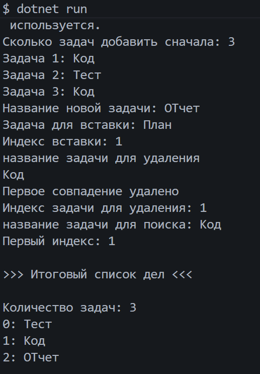

# Практическая работа №21

Автор: МИлад Бакулин  
Группа: ИСП-251

## Тема

Коллекция List в C#.

## Что реализовано

- ввод и вывод списка задач;
- добавление и вставка;
- удаление по значению и индексу;
- поиск первого совпадения;
- проверка допустимости индексов;
- обработка пустого списка.

## Короткие ответы

1. Чем List отличается от массива и как узнать количество элементов списка?

Ответ: Массив имеет фиксированную длину, заданную при создании. List - динамическая коллекция.

2. Чем отличаются Remove() и RemoveAt()?

Ответ: Remove() ищет первое совпадение по значению и удаляет его,RemoveAt() удаляет элемент по указанному индексу.

3. Почему для вставки допустим индекс Count, а для удаления — нет?

Ответ: Insert вставляет новый элемент перед элементом с указанным индексом. Индекс Count означает вставку в конец списка, Remove удаляет существующий элемент, а элемента с индексом Count нет, поэтому максимально допустимый индекс для удаления — Count - 1.

## Результат

